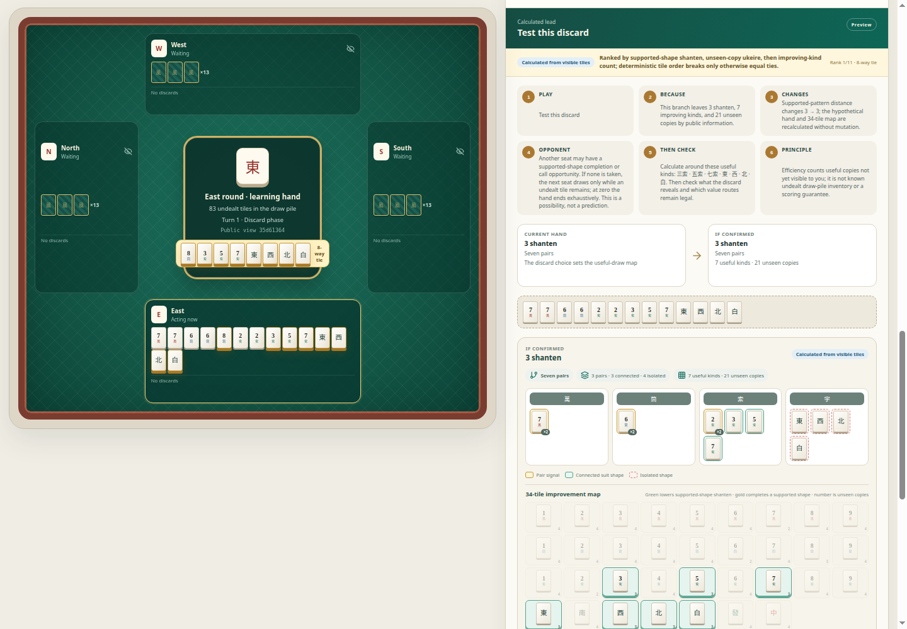

[English](../README.md) · [العربية](README.ar.md) · [Español](README.es.md) · [Français](README.fr.md) · [日本語](README.ja.md) · [한국어](README.ko.md) · [Tiếng Việt](README.vi.md) · [中文 (简体)](README.zh-Hans.md) · [中文（繁體）](README.zh-Hant.md) · [Deutsch](README.de.md) · [Русский](README.ru.md)

[](https://github.com/lachlanchen/lachlanchen/blob/main/figs/banner.png)

# LazyMahjong · Four Winds

*Возьмите тайл, сравните, разберите и подтвердите, не раскрывая руку другого игрока.*

[](https://lazying.art) [](../docs/images/app.png) [](https://github.com/sponsors/lachlanchen)

LazyMahjong — локальный учебный инструмент для принятия решений в японском риичи, китайском спортивном маджонге/MCR и гонконгском маджонге. Детерминированный TypeScript отвечает за стену, допустимые действия, скрытие информации, проверку завершения, историю и сохранение.

## Поддержка открытых инструментов обучения

| Donate | PayPal | Stripe |
| --- | --- | --- |
| [](https://chat.lazying.art/donate) | [](https://paypal.me/RongzhouChen) | [](https://buy.stripe.com/aFadR8gIaflgfQV6T4fw400) |

## Предварительный просмотр приложения

[](../docs/images/app.png)

На текущем столе отдельно показаны закрытая рука ученика, допустимые действия, предварительный просмотр без изменения состояния и данные с указанием происхождения.

## Чему учит игровой стол

- Воспроизводимый источник из 136 тайлов моделируется как общая стопка неразданных тайлов; поддерживаются четыре места, допустимые доборы, сбросы, объявления и возможности Рон/цумо завершить поддерживаемую форму. Мёртвая стена и дора Риичи не моделируются.
- Стандартная форма «четыре группы и пара» и профильные семь пар: семь разных видов в Riichi и этой версии Hong Kong; MCR считает скрытую четвёрку двумя единицами пары. Ожидания, сянтэн, укэирэ по невидимым копиям и карта 34 видов следуют профилю.
- Профили показывают границу учебного подмножества. Рон/цумо завершает раздачу только по поддерживаемой форме и не подтверждает допустимость счёта, яку/фан или отсутствие фуритена.
- Все равные лидеры показаны без предварительного выбора. Рейтинг: сянтэн, невидимое укэирэ, число видов; обязательный добор точен, завершение точно лишь для формы/легальности, пас — авторский совет.

## Карта репозитория

| Путь | Цель |
| --- | --- |
| [`src/domain/`](../src/domain/) | Детерминированные тайлы, профили правил, допустимые кандидаты, переходы состояния, скрытие информации и анализ руки. |
| [`src/i18n/catalogs.ts`](../src/i18n/catalogs.ts) | Одиннадцать полных каталогов для учащихся со стабильными ключами и заполнителями. |
| [`src/App.tsx`](../src/App.tsx) | Многоязычная настройка, игровой стол, лаборатория принятия решений, хроника и интерфейс сохранённой сессии. |
| [`docs/framework-contract.md`](../docs/framework-contract.md) | Точно поддерживаемые правила и явно отмеченные пробелы в подсчёте. |
| [`docs/engine-lane.md`](../docs/engine-lane.md) | Отключённый по умолчанию дополнительный канал движка и проверенная граница интеграции. |
| [`docs/images/app.png`](../docs/images/app.png) | Справочный снимок; обновить после браузерной проверки этой ревизии. |

## Быстрый старт

Требуется Node.js 20.19 или новее и npm.

```bash
npm ci
npm run dev
```

<http://127.0.0.1:5182/>

Серверы разработки и предпросмотра закреплены за `127.0.0.1:5182` и завершаются с ошибкой, не выбирая другой порт.

## Авторитет, конфиденциальность и доказательства

- Интерфейс показывает только публичный вид зрителя; другие руки, порядок стены, seed, частная оценка, право вызова и скрытые события паса остаются тайной до публичного вызова или завершения.
- Непрозрачные идентификаторы кандидатов связывают полный токен состояния, участника и каноническое действие. Координата, обозначение тайла, модель или устаревший кандидат не могут разрешить изменение состояния.
- Предварительный просмотр гипотетический. Следующий тайл стены остаётся скрытым до явного подтверждения допустимого добора.
- Точные, расчётные, авторские, движковые, модельные и аналогические данные разделены. «Невидимые копии» — четыре минус видимые этому зрителю тайлы, не известный состав стопки неразданных тайлов и не вероятность; неподдерживаемый счёт не угадывается.

## Проверка

```bash
npm run check
git diff --check
```

Проверка запускает строгий TypeScript, детерминированные тесты домена и сохранения, тесты серверного рендеринга UI и соответствия 11 языковых каталогов, производственную сборку, аудит зависимостей, проверку синтаксиса shell и тесты безопасности пути к необязательному движку.

## Цитирование

Если вы используете LazyMahjong в обучении или исследованиях, укажите репозиторий. GitHub считывает [CITATION.cff](../CITATION.cff) и отображает панель «Цитировать этот репозиторий».

```bibtex
@software{chen_lazy_mahjong_2026,
  author  = {Chen, Lachlan},
  title   = {LazyMahjong: Four Winds Mahjong Decision Teacher},
  year    = {2026},
  version = {0.1.0},
  url     = {https://github.com/lachlanchen/LazyMahjong}
}
```

## Статус

Этот выпуск — честно ограниченный учебный набор: ход тайлов, объявления, завершение, ожидания и анализ видимых тайлов детерминированы; полный подсчёт и выплаты Riichi, MCR и Hong Kong остаются будущей работой. Дополнительный канал движка по умолчанию отключён.
